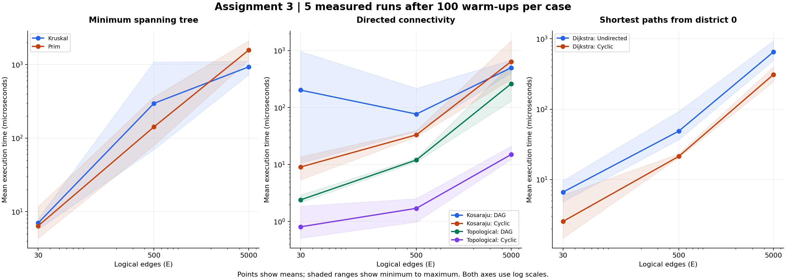
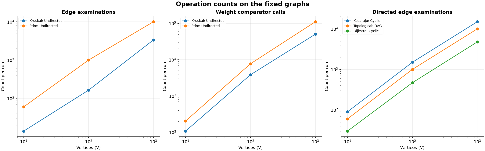

### MST time and total cost

| V | E | Kruskal (us) | Prim (us) | MST cost | Costs match |
| --- | --- | --- | --- | --- | --- |
| 10 | 30 | 7.014 | 6.405 | 129.0 | Yes |
| 100 | 500 | 296.727 | 142.124 | 1170.0 | Yes |
| 1000 | 5000 | 929.478 | 1572.356 | 13123.0 | Yes |

### MST operation counts

| V | Algorithm | Edge scans | Comparisons | Heap offers | Heap polls |
| --- | --- | --- | --- | --- | --- |
| 10 | Kruskal | 14 | 107 | 0 | 0 |
| 10 | Prim | 60 | 203 | 30 | 30 |
| 100 | Kruskal | 164 | 3827 | 0 | 0 |
| 100 | Prim | 1000 | 7697 | 500 | 500 |
| 1000 | Kruskal | 3356 | 50369 | 0 | 0 |
| 1000 | Prim | 10000 | 110958 | 5000 | 5000 |

### DSU operations inside Kruskal

| V | Union calls | Find calls | Parent traversals | Parent updates |
| --- | --- | --- | --- | --- |
| 10 | 14 | 28 | 32 | 11 |
| 100 | 164 | 328 | 508 | 149 |
| 1000 | 3356 | 6712 | 12334 | 1671 |

### SCC and topological ordering

| V | Graph | SCC (us) | SCC scans | SCC count | Topological (us) | Topo scans | Cycle found |
| --- | --- | --- | --- | --- | --- | --- | --- |
| 10 | DAG | 202.491 | 90 | 10 | 2.401 | 60 | No |
| 10 | Cyclic | 9.053 | 90 | 2 | 0.808 | 30 | Yes |
| 100 | DAG | 76.852 | 1500 | 100 | 12.029 | 1000 | No |
| 100 | Cyclic | 33.207 | 1500 | 20 | 1.703 | 500 | Yes |
| 1000 | DAG | 499.540 | 15000 | 1000 | 261.128 | 10000 | No |
| 1000 | Cyclic | 641.655 | 15000 | 200 | 14.973 | 5000 | Yes |

### Dijkstra from district 0

| V | Graph | Time (us) | Reachable | Edge scans | Relaxations | Comparisons | Heap offers | Validation scans |
| --- | --- | --- | --- | --- | --- | --- | --- | --- |
| 10 | Undirected | 6.621 | 10 | 60 | 17 | 82 | 18 | 30 |
| 10 | Cyclic | 2.534 | 10 | 30 | 10 | 21 | 11 | 30 |
| 100 | Undirected | 48.672 | 100 | 1000 | 199 | 2403 | 200 | 500 |
| 100 | Cyclic | 21.300 | 95 | 469 | 119 | 1020 | 120 | 500 |
| 1000 | Undirected | 649.715 | 1000 | 10000 | 1986 | 36698 | 1987 | 5000 |
| 1000 | Cyclic | 310.546 | 975 | 4766 | 1180 | 16842 | 1181 | 5000 |

### Timing variation across the five runs

| Algorithm | Graph | V | Mean (us) | Min (us) | Max (us) | Sample SD (us) |
| --- | --- | --- | --- | --- | --- | --- |
| Kruskal | Undirected | 10 | 7.014 | 5.741 | 7.988 | 0.807 |
| Prim | Undirected | 10 | 6.405 | 4.368 | 11.701 | 3.155 |
| Kosaraju | DAG | 10 | 202.491 | 10.539 | 966.148 | 426.898 |
| Kosaraju | Cyclic | 10 | 9.053 | 5.404 | 13.695 | 3.707 |
| Topological | DAG | 10 | 2.401 | 2.147 | 2.929 | 0.304 |
| Topological | Cyclic | 10 | 0.808 | 0.512 | 1.855 | 0.586 |
| Dijkstra | Undirected | 10 | 6.621 | 4.820 | 9.595 | 1.810 |
| Dijkstra | Cyclic | 10 | 2.534 | 1.469 | 6.030 | 1.962 |
| Kruskal | Undirected | 100 | 296.727 | 69.839 | 1085.086 | 443.259 |
| Prim | Undirected | 100 | 142.124 | 79.516 | 363.266 | 124.097 |
| Kosaraju | DAG | 100 | 76.852 | 38.588 | 218.410 | 79.177 |
| Kosaraju | Cyclic | 100 | 33.207 | 30.548 | 39.254 | 3.489 |
| Topological | DAG | 100 | 12.029 | 11.139 | 12.877 | 0.657 |
| Topological | Cyclic | 100 | 1.703 | 0.981 | 2.518 | 0.725 |
| Dijkstra | Undirected | 100 | 48.672 | 36.773 | 92.745 | 24.644 |
| Dijkstra | Cyclic | 100 | 21.300 | 20.501 | 23.133 | 1.057 |
| Kruskal | Undirected | 1000 | 929.478 | 725.810 | 1106.529 | 175.462 |
| Prim | Undirected | 1000 | 1572.356 | 1145.284 | 2106.762 | 482.793 |
| Kosaraju | DAG | 1000 | 499.540 | 405.768 | 681.536 | 127.986 |
| Kosaraju | Cyclic | 1000 | 641.655 | 314.663 | 1487.070 | 482.542 |
| Topological | DAG | 1000 | 261.128 | 129.450 | 570.776 | 179.089 |
| Topological | Cyclic | 1000 | 14.973 | 12.312 | 20.900 | 3.565 |
| Dijkstra | Undirected | 1000 | 649.715 | 493.257 | 938.127 | 194.010 |
| Dijkstra | Cyclic | 1000 | 310.546 | 246.860 | 396.911 | 63.375 |

### Plots

## Comparison and Discussion

Both MST algorithms gave the same cost at every size. On the large graph, Kruskal took 929.478 us and Prim took 1572.356 us, so Kruskal was faster in this run. Kruskal stops once it has V-1 edges, although it still sorts the whole edge list. This lazy version of Prim scans both directions of every road and later removes old heap entries. The comparison counts show that the two methods do different amounts of heap and sorting work. These results describe this implementation and these sparse graphs; they do not establish a winner for every graph.

Union by size attaches the smaller DSU tree to the larger one, which keeps the height small. Path compression points vertices directly at the root after a find. A later find therefore follows fewer links. Without either improvement, a poor union order can create a chain and one find can take O(V). With both improvements, a sequence of operations takes almost constant time per operation: O(alpha(V)) amortized. The DSU table records the work inside Kruskal; it is not a separate comparison with an unoptimized DSU. The test suite also checks that a repeated find on a deeper tree uses fewer parent traversals.

Kosaraju examines exactly 3E edges and visits each vertex twice. On cyclic graphs, its mean time grew by about 70.9 times from small to large, while V+E grew from 40 to 6000 (150 times). The work count agrees with O(V+E); elapsed time does not have to follow the same exact ratio. Allocation costs, cache effects and timing variation also affect these small measurements. The DAG has V singleton components, while the cyclic graph has V/5 components, so the number of output lists differs.

Topological ordering scans 2E edges on the DAG: one pass for indegrees and one while removing vertices. Every vertex in the cyclic benchmark has a predecessor inside its five-vertex ring. The initial queue is empty, so it detects failure after the E-edge indegree pass. Its lower time is caused by this input structure. A different cyclic graph can allow a large acyclic prefix to be processed first.

Dijkstra scans 2E adjacency entries on the connected undirected graphs, plus E logical edges during weight validation. On the directed graphs it scans outgoing edges only from reachable districts, while validation still checks all E edges. The reachable counts explain some of the difference between the two graph families. Heap comparisons and successful relaxations grow with graph size. Old heap entries are skipped when their stored distance no longer matches the best distance.

These graphs grow in both V and E at the same time. The two required plots show the same measurements against different horizontal axes, so they cannot isolate the effect of V from the effect of E. Also, E/V is 3 for the small graph and 5 for the other two. A larger study could vary the number of roads while keeping V fixed.

Each average uses all five measured runs. The tables include the minimum, maximum and sample standard deviation, and the plots show the minimum-to-maximum range. These are short runs in one shared environment, so scheduling, garbage collection and JVM compilation can affect the result. Operation counts are easier to reproduce than exact times. Counters are enabled during timing, so the measured times also include their small instrumentation cost.

One example of timing variation is Kosaraju on the small DAG: its mean was 202.491 us but its minimum was 10.539 us and its maximum was 966.148 us. Its mean was higher than the medium DAG mean. This does not mean a larger graph needs less theoretical work; the scan counts still grow from 90 to 1500. No run was removed to make the results look smoother.
